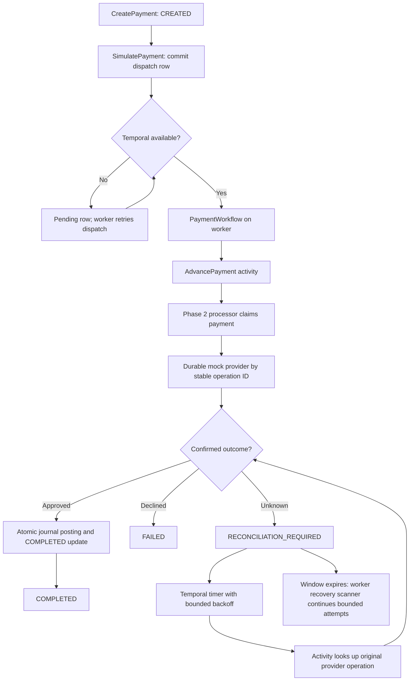
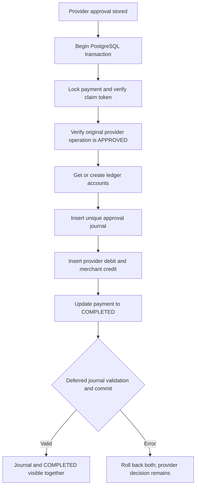

# PAYFLOW architecture

## Request and workflow path

The Go API mounts generated ConnectRPC v2 handlers. `CreatePayment` validates whole-yen JPY amounts and relies on PostgreSQL's unique `(merchant_id, idempotency_key)` constraint. An identical request returns the same payment, including its current status; a changed valid payload conflicts. Creating a payment never starts processing.

With development processing enabled, `SimulatePayment` commits one `payment_workflow_dispatch` row per payment before contacting Temporal. Its workflow ID is always `payflow-payment-<paymentId>`. Concurrent callers may attempt the same start; Temporal rejects duplicate workflow IDs, and the coordinator treats an already-started workflow as success. If Temporal is unavailable, the API returns `UNAVAILABLE` and the durable row stays pending. The worker scans pending rows every two seconds and retries dispatch after restarts or outages. If a start succeeds but marking it dispatched fails, the next scan attempts the same workflow ID. `SimulatePayment` returns the payment's current status, which may still be `CREATED` until a worker runs. `GetPayment` shows progress. `ReconcilePayment` remains a manual, immediate local operation.

The workflow only schedules activities and timers using Temporal's deterministic clock. All PostgreSQL reads and writes, provider calls, and random operation ID allocation happen in activities through the existing Phase 2 processor. `AdvancePayment` is safe to run again: it reads the current payment and either processes `CREATED`, reconciles an uncertain or expired claim, or returns a terminal status. Temporal activities have at-least-once execution, a 20-second start-to-close timeout, and up to three attempts with exponential backoff. The workflow uses configurable reconciliation intervals and maximum interval until its configured window expires. A persistently unknown provider timeout leaves the payment `RECONCILIATION_REQUIRED`; no failure is inferred.

## State and provider guarantees

The processor atomically changes `CREATED` to `PROCESSING`, assigning one provider operation ID, scenario, claim token, and 30-second lease. It never holds a payment transaction open during the provider call. Legal transitions are `CREATED → PROCESSING`, `PROCESSING → COMPLETED|FAILED|RECONCILIATION_REQUIRED`, and `RECONCILIATION_REQUIRED → PROCESSING`. Terminal states cannot transition. Go checks transitions; conditional SQL checks claim ownership; PostgreSQL triggers reject invalid status changes, changed operation IDs, terminal states without a matching provider decision, and new completions without an approval journal.

Reconciliation claims `RECONCILIATION_REQUIRED` or expired `PROCESSING`. It first looks up the original provider operation ID. A recorded decision is applied without another provider execution. A pending or absent decision may be retried with that same ID. If the payment update fails after provider approval, the lease expires and a later activity recovers the recorded decision. No new provider operation ID is allocated during reconciliation.

`internal/banking` owns the durable mock provider. `simulated_provider_operations` has one row per operation ID and one per payment. An approved row has one `logical_charge_id` equal to its operation ID. Provider upserts are idempotent across concurrent requests and worker restarts. This is a simulation artifact, not actual money movement.

| Scenario | First execution | Automatic reconciliation |
| --- | --- | --- |
| `APPROVE` | Stores approval | Completes payment |
| `DECLINE` | Stores decline | Fails payment |
| `TEMPORARY_FAILURE` | Stores pending and reports temporary error | Retries same ID, then approves |
| `NETWORK_TIMEOUT` | Stores pending and reports timeout | Remains uncertain through the configured window |
| `LOST_APPROVAL_RESPONSE` | Stores approval but reports lost response | Reads original approval and completes |

The provider and payment tables share local PostgreSQL but use separate statements. This models a provider decision that outlives a failed payment update. The provider decision, operation ID, and payment state survive API and worker process restarts. Temporal's development server keeps workflow history in its Compose SQLite volume, so ordinary worker restarts resume scheduled timers and activities.

## Double-entry accounting

Migration 004 adds `ledger_accounts`, `ledger_journals`, and `ledger_entries`. There is one shared `PROVIDER_RECEIVABLE` account per currency and one `MERCHANT_PAYABLE` account per merchant and currency. A `PAYMENT_APPROVAL` journal debits the provider receivable and credits the merchant payable by the approved whole-yen amount. The receivable is an unsettled simulated claim. It does not represent funds held at a bank.

`storage.Finish` opens the transaction only after the provider call has returned. It locks the `PROCESSING` payment, verifies its claim token, calls `ledger.PostApprovalTx`, updates the payment, and commits. A deferred PostgreSQL constraint trigger requires exactly one debit and one credit of positive, equal amounts in the journal currency; checks the account roles, merchant, payment amount, and durable provider approval; and requires the payment to be `COMPLETED` at commit. Another trigger requires the journal before any new `COMPLETED` transition. Journal and entry updates or deletions are rejected; entries can only be added in their journal's original posting transaction. A `(payment_id, purpose)` unique constraint and the payment row lock make retries and concurrent activities one accounting effect. The provider table also prevents rewriting a confirmed decision.

Read-only ledger methods return journals and entries by payment, provider receivable and merchant payable balances, and completed payments with missing or inconsistent journals. No ledger write is exposed through ConnectRPC. A decline or uncertain provider outcome creates no approval journal.

## Historical upgrade and operator recovery

Migration 004 preserves older `COMPLETED` payments, which have no ledger journal yet. After migration, run `operator issues` and the explicit `operator backfill --confirm` before starting processing. Backfill locks each historical payment, verifies its original provider operation is durably `APPROVED`, and posts the matching journal. It processes one payment per transaction, so interruption leaves earlier postings intact and rerunning skips them. An inconsistent historical record is reported and cannot be posted from its status label alone.

`cmd/operator` accepts loopback PostgreSQL connections only and has no public endpoint. Its inspection, balance, expired-claim, unresolved-payment, and ledger-issue commands are read-only. `recover ID --confirm` and `backfill --confirm` create `operator_actions` audit records; a trigger prevents deletion or rewriting after completion. Recovery accepts `RECONCILIATION_REQUIRED` or expired `PROCESSING`, rejects active claims and terminal payments, then calls the existing processor's reconciliation path. The processor looks up the original provider operation ID before retrying; conditional claims prevent overriding another worker. Unknown outcomes stay uncertain. The Phase 5 worker scanner also recovers abandoned claims automatically after PostgreSQL reconnects.

## Migration and API compatibility

Migrations 001–004 are unchanged. Forward migration 005 adds hashed merchant credentials, tenant and recovery indexes, and durable recovery scheduling columns. The migration runner records applied versions and runs each in a transaction. Existing payment and idempotency records remain intact. Phase 1 Protobuf fields and methods remain intact; `GetMerchantBalance` adds a merchant-scoped ledger view. The Phase 2 simulation methods still require `PAYFLOW_ENABLE_DEV_PROCESSING=true` and a loopback API address, as well as a merchant credential.

## Merchant security and observability

The API HTTP middleware validates a bearer key against a SHA-256 digest stored in `merchant_api_keys` and places the merchant identity in the request context. The handler derives `CreatePayment` ownership from this identity and checks ownership before lookup, simulation, or reconciliation. Cross-merchant payment IDs return `NOT_FOUND`; a spoofed `merchant_id` on creation returns `PERMISSION_DENIED`. `GetMerchantBalance` queries only the authenticated merchant's `MERCHANT_PAYABLE` account. Neither a request body nor an untrusted merchant ID authorizes access. The generated Connect contract remains compatible with existing fields. Directly constructed handlers used by earlier unit tests default to legacy unauthenticated mode; the actual API binary explicitly enables authentication. Internal Temporal activities and the loopback-only operator do not use the merchant HTTP path.

API keys are generated from 256 random bits and returned only at provisioning or rotation. The local credential CLI is limited to a loopback PostgreSQL connection. Rotation inserts a new hash and revokes the old key in one transaction. Revocation rejects subsequent requests. There is no OAuth, public credential management endpoint, rate limiting, or distributed secret manager yet.

The API and worker use JSON `slog` events. Static operation names and IDs correlate API request, Temporal workflow and activity, provider operation, and ledger commit. No secret, connection URL, or payment request body is logged. The metrics registry has a fixed vocabulary without ID labels. It records processing and reconciliation attempts and outcomes, dispatch, database and ledger errors, provider and API latency, plus gauges for backlog, expired leases, and ledger anomalies. OpenTelemetry meter instruments receive the same observations; local Prometheus text endpoints are bound to loopback. The API liveness endpoint has no dependency checks; readiness probes PostgreSQL and, when simulation is enabled, Temporal. Worker readiness probes PostgreSQL and Temporal after its poller starts. [Alert rules](alerts.yml) are provided for a local Prometheus setup.

## Automatic recovery

The worker periodically selects expired `PROCESSING` leases and `RECONCILIATION_REQUIRED` records. A short `FOR UPDATE SKIP LOCKED` transaction advances the durable retry count and next-attempt time so competing scanners do not schedule the same row. It commits before any provider call. The existing processor then atomically claims the payment, looks up the original provider operation, and either applies a confirmed decision or reuses that operation ID. Conditional claim tokens prevent an older attempt from overwriting another worker or a terminal state. Backoff grows with the attempt count and automatic attempts are bounded by configuration. After the limit, unknown outcomes stay unresolved for operator inspection. If PostgreSQL is unavailable, the scan fails and retries on the next interval; no status is guessed. An approval still requires one balanced journal in the completion transaction, and a decline posts no approval journal.

## Limits and next phase

- Only whole-yen JPY amounts are accepted. There is no real money movement, external bank, settlement, or refund.
- A permanently unknown outcome needs manual investigation after bounded automatic recovery attempts. The local `ReconcilePayment` operation remains available.
- A continuous PostgreSQL outage beyond the reconciliation window may leave the last persisted status at `PROCESSING` until connectivity returns and the worker's next recovery scan succeeds.
- This local design has no public credential lifecycle service, rate limiting, distributed tracing exporter, production Temporal deployment, notification routing, or automated settlement. The local metrics and operator interfaces must remain private.
