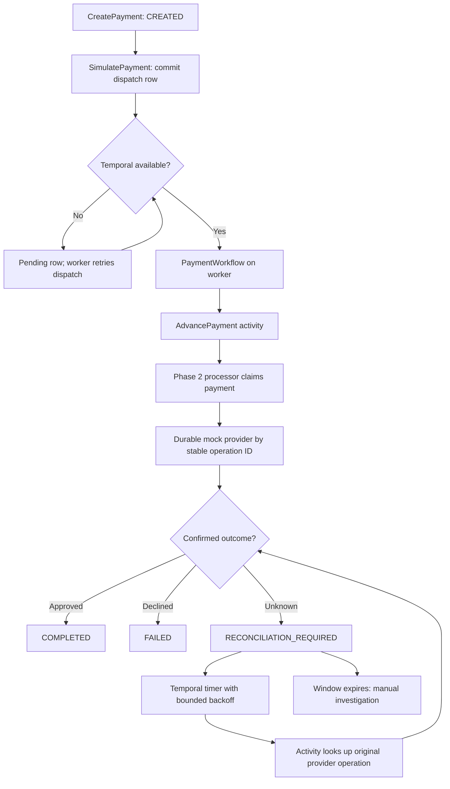

# PAYFLOW architecture

## Request and workflow path

The Go API mounts generated ConnectRPC v2 handlers. `CreatePayment` validates whole-yen JPY amounts and relies on PostgreSQL's unique `(merchant_id, idempotency_key)` constraint. An identical request returns the same payment, including its current status; a changed valid payload conflicts. Creating a payment never starts processing.

With development processing enabled, `SimulatePayment` commits one `payment_workflow_dispatch` row per payment before contacting Temporal. Its workflow ID is always `payflow-payment-<paymentId>`. Concurrent callers may attempt the same start; Temporal rejects duplicate workflow IDs, and the coordinator treats an already-started workflow as success. If Temporal is unavailable, the API returns `UNAVAILABLE` and the durable row stays pending. The worker scans pending rows every two seconds and retries dispatch after restarts or outages. If a start succeeds but marking it dispatched fails, the next scan attempts the same workflow ID. `SimulatePayment` returns the payment's current status, which may still be `CREATED` until a worker runs. `GetPayment` shows progress. `ReconcilePayment` remains a manual, immediate local operation.

The workflow only schedules activities and timers using Temporal's deterministic clock. All PostgreSQL reads and writes, provider calls, and random operation ID allocation happen in activities through the existing Phase 2 processor. `AdvancePayment` is safe to run again: it reads the current payment and either processes `CREATED`, reconciles an uncertain or expired claim, or returns a terminal status. Temporal activities have at-least-once execution, a 20-second start-to-close timeout, and up to three attempts with exponential backoff. The workflow uses configurable reconciliation intervals and maximum interval until its configured window expires. A persistently unknown provider timeout leaves the payment `RECONCILIATION_REQUIRED`; no failure is inferred.

## State and provider guarantees

The processor atomically changes `CREATED` to `PROCESSING`, assigning one provider operation ID, scenario, claim token, and 30-second lease. It never holds a payment transaction open during the provider call. Legal transitions are `CREATED → PROCESSING`, `PROCESSING → COMPLETED|FAILED|RECONCILIATION_REQUIRED`, and `RECONCILIATION_REQUIRED → PROCESSING`. Terminal states cannot transition. Go checks transitions; conditional SQL checks claim ownership; a PostgreSQL trigger rejects invalid status changes, changed operation IDs, and terminal states without a matching persisted provider approval or decline.

Reconciliation claims `RECONCILIATION_REQUIRED` or expired `PROCESSING`. It first looks up the original provider operation ID. A recorded decision is applied without another provider execution. A pending or absent decision may be retried with that same ID. If the payment update fails after provider approval, the lease expires and a later activity recovers the recorded decision. No new provider operation ID is allocated during reconciliation.

`internal/banking` owns the durable mock provider. `simulated_provider_operations` has one row per operation ID and one per payment. An approved row has one `logical_charge_id` equal to its operation ID. Provider upserts are idempotent across concurrent requests and worker restarts. This is a simulation artifact, not actual money movement.

| Scenario | First execution | Automatic reconciliation |
| --- | --- | --- |
| `APPROVE` | Stores approval | Completes payment |
| `DECLINE` | Stores decline | Fails payment |
| `TEMPORARY_FAILURE` | Stores pending and reports temporary error | Retries same ID, then approves |
| `NETWORK_TIMEOUT` | Stores pending and reports timeout | Remains uncertain through the configured window |
| `LOST_APPROVAL_RESPONSE` | Stores approval but reports lost response | Reads original approval and completes |

The provider and payment tables share local PostgreSQL but use separate statements. This models a provider decision that outlives a failed payment update. The provider decision, operation ID, and payment state survive API and worker process restarts. Temporal's development server keeps workflow history in its Compose SQLite volume, so ordinary worker restarts resume scheduled timers and activities.

## Migration and API compatibility

Migration 001 is unchanged. Migration 002 added the Phase 2 lifecycle and provider tables. Forward migration 003 adds the dispatch table without rewriting existing payments or idempotency keys. The migration runner records applied versions and runs each in a transaction. Phase 1 Protobuf fields and methods remain intact; the Phase 2 simulation methods still require `PAYFLOW_ENABLE_DEV_PROCESSING=true` and a loopback API address. They have no authentication layer and must remain local-only.

## Limits and next phase

- Only whole-yen JPY amounts are accepted. There is no real money movement, external bank, settlement, refund, or ledger.
- A permanently unknown outcome needs manual investigation after the reconciliation window. The local `ReconcilePayment` operation remains available.
- A continuous PostgreSQL outage beyond the reconciliation window may prevent the worker from recording `RECONCILIATION_REQUIRED`; the last persisted status can remain `PROCESSING` until the database returns and an operator reconciles it. A short reconciliation window relative to the 30-second lease also delays recovery of an interrupted claim.
- The development server, API, and worker are for local demonstration. There is no production Temporal deployment, access control, or operational alerting. Phase 4 could add a simulated double-entry ledger and explicit operator recovery tooling.
