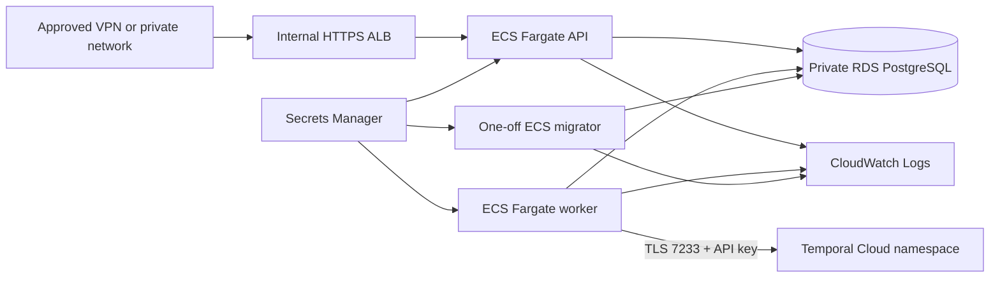

# AWS deployment architecture (Phase 6)

This is a **simulation** deployment design. It does not transfer funds or connect to a bank. Terraform is a proposed deployment configuration; this repository has not provisioned an AWS account.

## Network and trust boundaries

Terraform creates one VPC across two availability zones, with public NAT subnets, private application subnets, and isolated database subnets. The only Internet Gateway route belongs to NAT subnets. Each private application subnet routes outbound traffic through a NAT gateway in the same zone for ECR layers, CloudWatch Logs, Secrets Manager, and Temporal Cloud. The database subnets have no default route. API, worker, and migration tasks have no public IP. RDS is not publicly accessible. There is no public ALB.

The internal ALB has an HTTPS listener using a pre-existing ACM certificate. Its security group accepts port 443 only from `private_client_cidr`; the API accepts port 8080 only from the ALB. **A routed VPN, Direct Connect, or equivalent approved private client path must exist outside this Terraform module.** A CIDR rule by itself creates no client connectivity or authentication. The certificate must match the private hostname used by clients; the generated AWS ALB DNS name will generally not match your certificate. ConnectRPC merchant bearer authentication remains mandatory. Health probes are unauthenticated within the ALB/API trust boundary.

The worker and migration task have no ALB listener. API, worker, and migration tasks can reach RDS only on 5432. Worker outbound 7233 reaches Temporal Cloud; all task types have outbound 443 for Fargate bootstrap and AWS service access. Security groups and private routing form a baseline; NAT egress is broad by destination and should be narrowed with approved endpoints or an egress firewall if the environment requires it.

## Data, secrets, and identities

RDS PostgreSQL 17.6 uses encrypted gp3 storage, Multi-AZ, automated backups, deletion protection, a final snapshot, an isolated subnet group, and a parameter group with `rds.force_ssl=1`. The Terraform-managed RDS master password is an AWS managed Secrets Manager value. The application must use a **separate least-privilege database user**, created through an approved private database administration path. The application URL secret must include the RDS DNS hostname, `sslmode=verify-full`, and `sslrootcert=/etc/ssl/certs/rds-global-bundle.pem`. The CA bundle is copied into every container. API, worker, and migrator reject a production URL lacking hostname-verified TLS.

Terraform creates three Secrets Manager secret containers without secret versions: a runtime `DATABASE_URL`, a migration `DATABASE_URL`, and a Temporal Cloud API key. The database URLs should use distinct roles: runtime data access for API/worker, schema ownership and migration privileges for the one-off migrator. Values are installed outside Terraform so they do not enter Terraform state. ECS execution roles can read only their respective secrets, pull their own ECR image, and write their own CloudWatch log group. Application task roles have no AWS permissions. Rotating a secret requires starting fresh tasks because ECS injects values at task startup.

The worker connects to an independently provisioned Temporal Cloud namespace using the SDK's API key credentials and verified TLS. Production rejects local/default Temporal settings and a missing key. The API does not connect to Temporal when development simulation is disabled. Temporal Cloud setup, API key lifecycle, and account limits are external prerequisites.

Temporal Cloud also supports mutual TLS credentials. This module chooses API keys to keep ECS secret rotation straightforward; an mTLS variant would need a separate reviewed certificate/key delivery and rotation design and is not configured here.

## Service lifecycle and visibility

The first Terraform stage creates network, RDS, ECR, ALB, IAM, logs, and secret containers. `enable_runtime=false` keeps task definitions and services absent until images, credentials, and Temporal Cloud are prepared. The second stage creates pinned image task definitions and zero-count services. A one-off migration task runs before any API or worker task is scaled. The `migrations_complete` variable guards a nonzero desired count. An upgraded Phase 1–3 database may need the separate, approval-verified historical ledger backfill described in [deployment](deployment.md).

API readiness checks PostgreSQL. Worker readiness checks PostgreSQL and Temporal after its poller starts. ECS health checks and ALB target health use `/readyz`. JSON application logs flow to CloudWatch with configurable retention, and CloudWatch alarms cover RDS storage/CPU, API target availability, and worker CPU. No alarm notification destination is configured. Existing `/metrics` endpoints remain loopback-only within the task and are **not** exposed by the ALB; private metrics collection and alert routing are future integration work. Correlation IDs and bounded metric labels remain as in [architecture](architecture.md).

The production API binds `0.0.0.0:8080` behind the private ALB. `PAYFLOW_ENABLE_DEV_PROCESSING=false`; the `SimulatePayment` and `ReconcilePayment` methods remain disabled in production. The current production API supports authenticated creation, retrieval, and balance queries. A safe, separately authorized processing trigger for newly created payments is **not implemented** here. Existing workflows and recovery records can be handled by the worker. No public/admin/metrics/simulation endpoint is added.

## Remaining production boundaries

- No remote credential-provisioning or backfill command is supplied. The current CLIs deliberately require a loopback database; do not weaken that check for deployment. Provision merchant keys and perform verified historical backfill through a reviewed private administration workflow before accepting production requests.
- This module does not create a VPN, private DNS record, ACM certificate, S3 state bucket, Temporal Cloud namespace, or notification routing. They are prerequisites or later work.
- The mock provider and ledger are still simulated data. RDS and Temporal Cloud costs accrue if deployed even when ECS desired counts are zero.

AWS references: [Fargate task networking](https://docs.aws.amazon.com/AmazonECS/latest/developerguide/fargate-task-networking.html), [private task outbound routing](https://docs.aws.amazon.com/AmazonECS/latest/developerguide/networking-outbound.html), [ECS secret injection](https://docs.aws.amazon.com/AmazonECS/latest/developerguide/specifying-sensitive-data-tutorial.html), [RDS PostgreSQL TLS](https://docs.aws.amazon.com/AmazonRDS/latest/UserGuide/PostgreSQL.Concepts.General.SSL.html), [Temporal Cloud authentication](https://docs.temporal.io/cloud/get-started).
