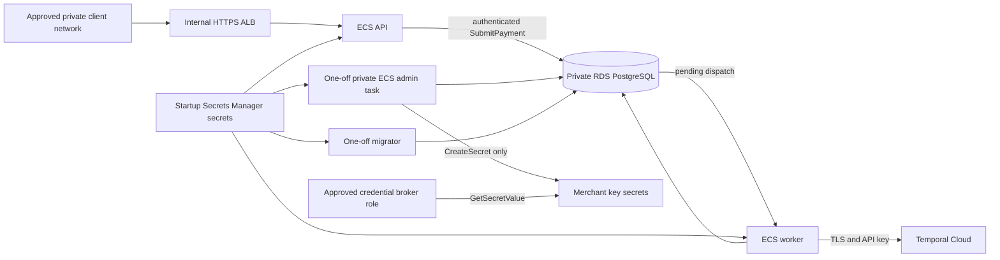

# Private AWS simulation architecture (Phase 7)

This is a proposed deployment of a **simulated** payment system. No funds move, no banking service is called, and this repository has not provisioned AWS resources.

## Network and trust boundaries

Terraform creates one VPC in two availability zones, public NAT subnets, private application subnets, and isolated database subnets. Only NAT subnets have an Internet Gateway route. API, worker, migrator, and admin tasks have no public IP; RDS is private. Worker and admin tasks have no load balancer listener. The internal HTTPS ALB accepts port 443 only from `private_client_cidr`; a VPN, Direct Connect, or equivalent routed private client path and matching private DNS and ACM certificate must be supplied separately. The CIDR rule does not create that route or authenticate clients. The API accepts port 8080 only from the ALB. Every merchant RPC requires a bearer credential; `/readyz` and `/healthz` remain internal health probes.

Application tasks reach RDS on 5432 through security group rules. Private task subnets use NAT for ECR, CloudWatch, Secrets Manager, and Temporal Cloud; the database subnets have no default route. The worker uses outbound 7233 to Temporal Cloud. Task outbound 443 currently permits broad destinations through NAT, so an environment requiring stricter egress needs reviewed endpoints or a firewall. Local metrics listeners bind loopback within containers and have no ALB route.

## Merchant submission and durable processing

`CreatePayment` stores an authenticated merchant's payment and does not process it. `SubmitPayment` checks the merchant owns the ID, chooses an approve or decline **mock** scenario using a stable hash of the server-generated payment UUID, and commits one `payment_workflow_dispatch` row. The API does not connect to Temporal for this call. The worker scans pending rows, starts `payflow-payment-<payment ID>`, and retries after failures or restarts. Concurrent submissions use the same row and workflow ID. `GetPayment` exposes eventual progress; a successful submission response may still show `CREATED`.

The workflow invokes the existing idempotent processor. A payment is claimed before a provider call, with a stable operation ID and a lease; the database transaction ends before the call. The durable mock provider stores one decision per operation ID. Confirmed approval commits one balanced journal and `COMPLETED`; confirmed decline commits `FAILED`. A timeout or lost response becomes `RECONCILIATION_REQUIRED` until the original operation can be checked. Retrying a workflow, worker, or provider call never allocates a second logical operation for the same payment. An unknown outcome is never guessed. The mock outcome policy is only for demonstration, not risk assessment or real banking.

Production sets `PAYFLOW_ENABLE_DEV_PROCESSING=false`. `SimulatePayment` and `ReconcilePayment` remain disabled on the private ALB. The production `SubmitPayment` request has no scenario selector. There is no public operator or credential endpoint.

## Database, credentials, and IAM

RDS PostgreSQL uses encrypted storage, Multi-AZ, backups, deletion protection, a final snapshot, and `rds.force_ssl=1`. Each database URL must use the RDS DNS name, `sslmode=verify-full`, and the bundled RDS CA at `/etc/ssl/certs/rds-global-bundle.pem`. The runtime, migration, and administration URLs are distinct Secrets Manager secret containers populated outside Terraform. Use distinct database roles: runtime DML, migration schema ownership and DDL, and administration limited to the credential tables plus required recovery and ledger functions/tables. These SQL grants and role creation are an external prerequisite; Terraform cannot prove them.

ECS execution roles read only their respective startup secret, image, and log group. API, worker, and migrator task roles have no AWS permissions. The one-off admin task role can **create** secrets only under the PAYFLOW merchant-key prefix; it cannot retrieve them. New credentials are 256-bit random values. Migration 006 adds an inactive key state and durable request-ID audit. The admin task first commits the new hash as inactive, creates a uniquely named Secrets Manager secret, then activates the key. Rotation revokes the old key only in the same database transaction that activates the delivered replacement. A failed or uncertain secret creation leaves the new key inactive and the old key usable; its audit state requires private review. The task emits only IDs, states, and secret ARNs, never raw keys. Repeated request IDs do not generate another active key.

The approved, pre-existing credential broker role receives `GetSecretValue` and `DescribeSecret` for PAYFLOW merchant-key secrets. That role must deliver a credential over an approved channel; its trust policy, access approval, and actual delivery mechanism are outside this repository. An approved, pre-existing invoker role receives permission to run only the admin task on this cluster and to pass only its task and execution roles. Its MFA, trust policy, and approval flow remain account responsibilities. ECS invocation and Secrets Manager access must be reviewed in CloudTrail. The task definition sets a generic actor label; CloudTrail identifies the actual invoker. No key is passed in ECS command arguments, task output, or Terraform state. Secrets remain accessible to account principals with broader IAM authority, so the AWS account boundary must be managed accordingly.

The same admin task has a fixed command allowlist for audited recovery, backfill, and inspection. Mutations require `--confirm`. It cannot execute arbitrary shell input and has no listener. The existing loopback-only local credential and operator CLIs remain local.

## Rollout gates and visibility

With `enable_runtime=false`, Terraform creates infrastructure and empty startup secret containers without running services. Image digests and secret values are provided through separately approved procedures. With `enable_runtime=true`, task definitions and zero-count services are registered. `enable_admin=true` registers the private admin task once approved recipient and invoker roles are supplied. Scale-out is guarded by `migrations_complete`, `deployment_prerequisites_reviewed`, and `enable_admin`; these are manual attestations, not proof that external systems work. Run the one-off migrator and any provider-verified historical ledger backfill before service scale-out. See [deployment](deployment.md) for the review checklist and PowerShell commands.

API readiness checks PostgreSQL. Worker readiness checks PostgreSQL and Temporal after its poller starts. Application JSON logs use separate CloudWatch groups; CloudWatch alarms cover basic RDS and service health, but no notification destination is configured. Secrets injected into ECS are refreshed only when tasks restart. The admin task itself is not long-running.

AWS references: [ECS task roles](https://docs.aws.amazon.com/AmazonECS/latest/developerguide/task-iam-roles.html), [Secrets Manager CreateSecret](https://docs.aws.amazon.com/secretsmanager/latest/apireference/API_CreateSecret.html), [RDS PostgreSQL TLS](https://docs.aws.amazon.com/AmazonRDS/latest/UserGuide/PostgreSQL.Concepts.General.SSL.html), [Temporal Cloud setup](https://docs.temporal.io/cloud/get-started).
